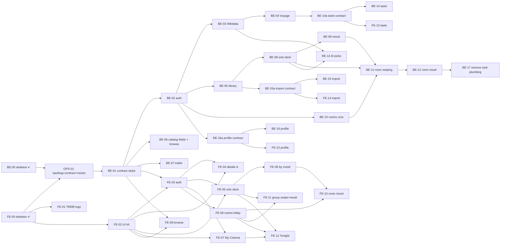

# Backlog — Ithaca

**Purpose:** the ordered, dependency-aware backlog for the backend and frontend agents working in parallel (ADR-0021).
Each task is sized for one focused session and one PR.
**How to use:** pick the lowest-numbered task in your lane whose dependencies are **Done** and that nobody has claimed;
run `/do-task <ID>` (other agents: follow AGENTS.md §4 by hand); update its status line here in the same PR. The claim is
a draft PR titled `[<ID>] …`, opened right after your first push (AGENTS.md §4.1).

Status values: `Todo` · `In progress` · `Done` · `Blocked (reason)`.

Every task inherits the **Definition of Done**: AGENTS.md §2 rules, §4 process (CI green, squash-merged), the §5 report,
and the docs it changes updated in the same PR. "Tests" lists the minimum; add more when behaviour warrants. Contract
sections (`§n`) are in [api-contract.md](api-contract.md); every FE task adds MSW handlers for what it consumes
([frontend conventions → Mock API](frontend-conventions.md#mock-api)).

---

## Lanes and order

**Parallel lanes once BE-01 is Done:** Backend (BE-02…BE-17) ‖ Frontend (FE-02…FE-15) against MSW mocks typed from
`contracts/openapi.json` (ADR-0020). Frontend tasks need only the *contract* (BE-01, or BE-14a / BE-15a / BE-16a for the
second wave), never the backend logic. When the matching BE task is Done, the frontend checks the screen against the real
API (`VITE_API_MOCKS=off`) and fixes any gap in its next task or a follow-up issue. FE-01 and FE-02 need nothing from the
backend and can start at once (FE-01 after the owner approves the asset). Ops: OPS-02 any time; OPS-03 after BE-08 + FE-05.

| Lane | Order | Notes |
|---|---|---|
| Backend | BE-01 → BE-02 → BE-03 → BE-04 → BE-05 → BE-06 → BE-07 → BE-08 → BE-09 → BE-10 → BE-11 → BE-12 → BE-13 → BE-14a → BE-14 → BE-15a → BE-15 → BE-16a → BE-16 → BE-17 | BE-06/BE-07 need only BE-01; the `a` contract tasks are small and may be pulled earlier so FE-13–15 can start |
| Frontend | FE-01 (when approved) · FE-02 → FE-03 → FE-04 → FE-05 → FE-06 → FE-07 → FE-08 → FE-09 → FE-10 → FE-11 → FE-12 → FE-13 → FE-14 → FE-15 | all on mocks |

With a second agent per side, tasks with no path between them can also run in parallel (BE-05 ‖ BE-06, FE-07 ‖ FE-08).
Two backend tasks that add EF migrations merge one at a time: the later one deletes its migration, updates from `main`,
re-adds it (AGENTS.md §4.2).

**Changes vs. the suggested order:**
- **Library (BE-05) moves ahead of the solo deck (BE-08).** An "up" swipe writes `UserFilm`, and ADR-0019's refresh-not-purge rule must exist before anything references films.
- **Rooms come after the solo deck**, because the shared deck reuses the deck builder.
- **Wikidata and Voyage (BE-03, BE-04) stay right after auth, as requested**, although only BE-13 (AI picks) and BE-14 (taste) need them. If they stall, the backend agent may take BE-05…BE-12 first and says so in its report.
- **Second-wave contracts (taste, import, profile) are separate small `a` tasks**, so their FE tasks don't wait for the logic.

---

## Foundation

### BE-00 — Backend skeleton, real clients, decisions · `Done` (PRs #1, #2 and earlier)
Four-layer solution (Domain ← Application ← Infrastructure ← Api), Result/Error + ProblemDetails, `IAppDbContext`,
options via `IConfigSection`, architecture tests, pgvector `films` table, reference slice `GET /api/films/{tmdbId}`,
`GET /api/health`, `RoomHub` (connect only), `AnthropicLlmClient`, `TmdbHttpClient`, `CatalogSyncService`
(`--sync-catalog`), prompts + evals, Docker stack, CI with OpenAPI/migration drift checks, ADRs 0001–0019.
Verified: build, 43 tests, evals, Docker smoke.

### FE-00 — Frontend skeleton, tokens, shell · `Done` (same PRs)
Vite + React 19 + TS strict, Tailwind v4 tokens (default palette off) + token lint, TanStack Query, openapi-fetch with
generated types, `ApiError` + `problem.ts`, `notify` (sonner), `useRoomHub`, app shell (header + ☰ `MenuSheet`, TMDB
attribution footer), `PlaceholderPage` for every route, `/dev/status`, `FilmPage` reference slice. Verified: typecheck,
lint, test, build.

### OPS-01 — Backlog, API contract, MSW mocks, parallel-agent workflow · `Done` (PR #3)
- **Objective:** let a backend and a frontend agent work in parallel without blocking or overwriting each other.
- **Deps:** BE-00, FE-00. **Modules:** `docs/`, `AGENTS.md`, `CLAUDE.md`, `.claude/commands/`, `src/frontend/src/mocks`,
  `src/frontend/src/test`, `src/frontend` tooling.
- **Contract:** writes docs/api-contract.md (design only).
- **Scope:** in: this backlog, the contract, MSW (dev toggle, Vitest, production exclusion), ADR-0020/0021, AGENTS.md §4,
  `/do-task`, design reference. Out: any endpoint, entity or screen.
- **Acceptance:** mocks answer `/api/health` and `/api/films/{tmdbId}` in dev and Vitest; unhandled requests fail tests;
  the production build has no mock code; all AGENTS.md §1 checks green.
- **Tests:** `src/mocks/handlers.test.ts`.

### BE-01 — Contract stubs for every first-wave endpoint · `In progress`
- **Objective:** make api-contract.md §4–§9 executable: every DTO, enum and action exists with its final route and
  `[ProducesResponseType]`s, and returns 501 until its feature task lands, so `contracts/openapi.json` and `schema.d.ts`
  exist before any logic.
- **Deps:** OPS-01. **Modules:** `Ithaca.Application/<Feature>/` (DTOs, `<Feature>Errors`, stub services),
  `Ithaca.Api/Controllers/`, `ErrorCodes.cs`, `ErrorStatusCodes.cs`, `src/frontend/src/shared/api/problem.ts`,
  `contracts/openapi.json`, `schema.d.ts`.
- **Contract:** §2 (all codes, incl. `server.not_implemented` → 501), §3–§9 shapes.
- **Scope:** in: one sealed service per feature with final signatures returning `server.not_implemented`; thin controllers;
  `FilmDto` gains its new nullable fields (null until BE-06); `export-openapi.sh`; `npm run api:types`. Out: auth
  enforcement, entities, migrations, logic.
- **Acceptance:** every §4–§9 endpoint is in `openapi.json` with the documented request, response and statuses; each
  answers 501 ProblemDetails `server.not_implemented` (health/films unchanged); enums are strings; the frontend and its
  mocks compile against the new types.
- **Tests:** one parameterised slice test (each stub → 501 + code); `ErrorStatusCodesTests`; OpenAPI drift.
- **Docs:** api-contract.md (deviations found), backend-conventions.md (a line on stubs).

### FE-01 — TMDB logo in the footer · `Todo` (needs the owner's OK to download the official asset)
- **Objective:** meet TMDB's attribution terms (ADR-0017): logo next to the existing notice, less prominent than the
  Ithaca wordmark.
- **Deps:** FE-00, owner approval. **Modules:** `src/frontend/src/app/layout/AppFooter.tsx`, the asset under
  `src/frontend/src/shared/ui/` (or `public/`).
- **Contract:** none.
- **Scope:** in: the official logo from TMDB's branding page, alt text, sizing. Out: any other TMDB branding.
- **Acceptance:** logo on every page, visibly smaller than the wordmark; token lint passes (colours stay in the asset).
- **Tests:** build only. **Docs:** a follow-up note under ADR-0017's Outcome that the logo is done.

### FE-02 — UI kit from the design canvas · `Todo`
- **Objective:** the shared building blocks every screen uses, in the canvas' visual language (frontend-conventions.md →
  Design reference).
- **Deps:** FE-00. **Modules:** `src/frontend/src/shared/ui/`, `src/frontend/src/app/dev/`, test setup.
- **Contract:** none.
- **Scope:** in: pill `Button` (ink / yellow / pink / outline), `IconButton` (44px, aria-label required), `TicketCard`
  (dashed tear line, notches, "ADMIT 1" stub), `Chip`/`ToggleChip`, `SegmentedControl`, `Poster` (TMDB image URL +
  placeholder), `StubRating` (1–5 stubs, radio group), `Sheet` (native `<dialog>`), `MonoLabel`; a `/dev/ui` gallery (dev
  builds only); Testing Library + jsdom (ADR-0010 "when needed": now). Out: screens.
- **Acceptance:** tokens only, keyboard and screen-reader usable, ≥ 44px targets; gallery shows each piece at 375px.
- **Tests:** StubRating keyboard, Sheet focus, Button variants.
- **Docs:** frontend-conventions.md (shared UI list).

## Auth

### BE-02 — Users, guests, session and antiforgery (ADR-0012) · `Todo`
- **Objective:** cookie auth for users, the guest principal plumbing, `/api/auth/*`, antiforgery (FlowOps' XSRF pattern).
- **Deps:** BE-01. **Modules:** `Infrastructure/Identity` (or `Persistence`), `Application/Users`,
  `Api/Controllers/AuthController.cs`, `Program.cs`, migration.
- **Contract:** §4, §2 auth codes.
- **Scope:** in: Identity on `AppDbContext` (email + password, lockout 5/15 min); cookie scheme (HttpOnly, Lax, Secure in
  Production, 401/403 JSON, no redirects); `Guest` entity and a guest principal in the same scheme (guest id + room id),
  issued later by BE-10; an Application `ICurrentActor` so services never touch `HttpContext`; `XSRF-TOKEN` cookie +
  `X-XSRF-TOKEN` header on unsafe methods, re-issued on principal change, failure → 400 `auth.antiforgery_failed`.
  Out: Google/Apple (P-02), profile (BE-16), guest upgrade (BE-10).
- **Acceptance:** register → 201 signed in → `me`; wrong password and locked account answer identically; sign-out clears
  the cookie; unsafe request without the header → 400; unauthenticated → 401 JSON; tests stay offline.
- **Tests:** register/sign-in/sign-out/me, duplicate email, lockout, antiforgery missing/invalid, 401 shape, cookie flags.
- **Docs:** api-contract.md §4 as built; backend-conventions.md (getting the actor); an ADR for any deviation from FlowOps.

### FE-03 — Sign-in screen and session · `Todo`
- **Objective:** the Welcome board at `/sign-in`, session hooks, antiforgery header, user-only routes.
- **Deps:** BE-01, FE-02. **Modules:** `src/features/auth/`, `src/shared/api/client.ts`, `src/app/routes.tsx`,
  `src/app/layout/MenuSheet.tsx`, `src/shared/query/queryKeys.ts`, `src/mocks/`.
- **Contract:** §4.
- **Scope:** in: email sign-in, create account, "Have a room code?" → join; `useCurrentUser`/`useSignIn`/`useRegister`/
  `useSignOut`; send `X-XSRF-TOKEN` from the `XSRF-TOKEN` cookie on unsafe methods; `RequireUser` wrapper →
  `/sign-in?next=…`; sign-in/out in the menu; mock auth store (signed in by default, switchable in tests). Out: "Continue
  with Google" (hidden until P-02), profile.
- **Acceptance:** with mocks: sign in, reload keeps the session, sign out; `auth.invalid_credentials` message; 400 field
  errors under the fields; a guest (`kind: "guest"`) counts as signed out for user-only routes.
- **Tests:** XSRF header (Vitest + MSW), hooks, `RequireUser` redirect.
- **Docs:** frontend-conventions.md (session and guard pattern).

## Catalog & AI

### BE-03 — Wikidata enricher (ADR-0017) · `Todo`
- **Objective:** AI-safe film facts from Wikidata (CC0), and the embedding text built only from them.
- **Deps:** BE-02 (order only). **Modules:** `Application/Catalog`, `Infrastructure/Wikidata` (typed `HttpClient`),
  `Domain/Films`, migration, `CatalogSyncService`.
- **Contract:** none (internal).
- **Scope:** in: `IWikidataClient` over the SPARQL endpoint; link films by Wikidata's TMDB movie id property (no title
  matching); store genres, main subjects, directors, cast, countries, languages, year, runtime, awards; a deterministic
  embedding-text builder from those fields only; run in the sync in resumable batches; descriptive User-Agent with a
  project contact (no personal email); the 180-day TMDB rule untouched. Out: embeddings (BE-04), Wikipedia text.
- **Acceptance:** matched films get facts and an embedding text; unmatched films are logged and skipped; a test proves the
  text never contains TMDB-derived fields; no live calls in tests.
- **Tests:** stub `HttpMessageHandler` with recorded SPARQL replies; builder unit tests; "no TMDB text" test.
- **Docs:** docs/ai.md (data sources, enricher).

### BE-04 — Voyage embedding client (ADR-0013) · `Todo`
- **Objective:** real embeddings of the Wikidata text with Voyage (the key `Ai:EmbeddingApiKey` is in user-secrets).
- **Deps:** BE-03. **Modules:** `Infrastructure/Ai/VoyageEmbeddingClient.cs`, `Application/Ai/IEmbeddingClient.cs`,
  `Infrastructure/DependencyInjection.cs` (`AddExternalClients` + startup validation), `CatalogSyncService`,
  `CatalogSyncOptions`, `appsettings.json`.
- **Contract:** none (internal).
- **Scope:** in: typed `HttpClient` (no official .NET SDK) over `POST https://api.voyageai.com/v1/embeddings`, model
  `voyage-4`, `output_dimension` 1024, `input_type` `document` for films and `query` for mood/taste text (extend
  `IEmbeddingClient` with a batch method and the input type); up to 1,000 texts per request; back off on 429 honouring
  `Retry-After` (no payment method yet, so limits are low; 200M free tokens per model); `Voyage` in the provider switch,
  key required at startup; the sync embeds the Wikidata text in batches and **replaces** `CatalogSync:EmbedOverviews`
  (TMDB text), which is removed. Out: taste vectors (BE-14).
- **Acceptance:** `Ai:EmbeddingProvider=Voyage` without a key fails startup clearly; the sync re-embeds only changed films
  and records `embedding_model`; `EmbedOverviews` is gone; no network calls in tests.
- **Tests:** stub handler: request shape, batching, 429 back-off, dimension check, failure → Result; sync with the Fake.
- **Docs:** docs/ai.md (embeddings, keys, provider table).

### BE-13 — AI picks: ranking and reasons from Wikidata · `Todo`
- **Objective:** better top 3 / compromise order and a one-line reason per pick, without any TMDB text reaching the LLM.
- **Deps:** BE-03, BE-08 (BE-12 for rooms). **Modules:** `Application/Decks`, `Application/Rooms`, `Application/Ai`,
  `prompts/`, `evals/cases/`.
- **Contract:** §5 `TopPickDto.reason`; adds a `reason` to `RoomPickDto` (additive contract change in this task).
- **Scope:** in: `rank-candidates` / `explain-pick` over Wikidata facts + our own user data only; every returned `tmdbId`
  validated against the candidates; the existing `Ai:ModelOverrides` set for these prompts. Out: the personal "WHY" note
  on details (P-03).
- **Acceptance:** a test proves no TMDB text in any prompt; invalid ids dropped; AI failure → picks without reasons, not
  an error.
- **Tests:** prompt-variable test; eval cases incl. a "must not" case.
- **Docs:** docs/ai.md, prompts/README.md.

## Deck

### BE-08 — Solo deck: Just swipe · `Todo`
- **Objective:** a user's solo deck with a sampler that adapts as they swipe.
- **Deps:** BE-02, BE-05. **Modules:** `Domain/Decks`, `Application/Decks`, `Api/Controllers/DecksController.cs`,
  configurations, migration.
- **Contract:** §5 (`source: "justSwipe"`).
- **Scope:** in: deck + `DeckItem` entities; sampler (varied genres/decades by popularity); next batches adapted from the
  user's swipes and library (genres, runtime; embeddings when present); idempotent swipes (`swipeId`); library effects of
  `up`; top 3 from our own data (`reason: null`); glossary names for the solo deck's parent and a solo swipe (A12). Out:
  mood (BE-09), AI ranking (BE-13), taste (BE-14).
- **Acceptance:** §5 for `justSwipe`; no film twice in a deck; seen films excluded; a retried swipe is a no-op.
- **Tests:** slice tests per endpoint/error; sampler variety; adaptation units; idempotency.
- **Docs:** api-contract.md §5 as built; glossary.

### FE-05 — Solo deck, swipe and top 3 · `Todo`
- **Objective:** the "Solo — the deck" and "Solo — your top 3" boards.
- **Deps:** BE-01, FE-02, FE-03. **Modules:** `src/features/deck/`, `src/app/routes.tsx`, `queryKeys.ts`, `src/mocks/`.
- **Contract:** §5.
- **Scope:** in: `/deck` starts Just swipe → `/deck/:deckId`; card stack with drag right/left/up plus buttons and keyboard;
  up → Loved it / Not for me / Skip sheet; prefetch the next batch near the end; top 3 at `/deck/:deckId/top`; a reusable
  `SwipeCard` + `useSwipeGesture` for FE-11; a watchlist button on the card, separate from the swipe, at the bottom or
  left of the card (A2; `PUT`/`DELETE /api/library/{tmdbId}/watchlist`); `prefers-reduced-motion`. Out: "learning" chips (P-06), where-to-watch lines.
- **Acceptance:** with mocks: a full batch by touch, mouse and keyboard; one request per swipe with a stable `swipeId`; a
  failed swipe toasts and the card returns; top 3 shows 1–3 picks and the `deck.no_yeses` state.
- **Tests:** gesture → direction (pure), swipe idempotency, flow with MSW.
- **Docs:** none (routes decided, A4).

## Mood

### BE-09 — Decks by mood · `Todo`
- **Objective:** start a deck from tapped moods and free text.
- **Deps:** BE-08. **Modules:** `Domain/Moods`, `Application/Moods`, `Application/Decks`, migration.
- **Contract:** §5 (`source: "mood"`, `MoodQuery`).
- **Scope:** in: `MoodQuery` entity; chips → genres/filters by a server-side table (no LLM); free text →
  `mood-parse.v1` → `MoodParseOutput`, genres validated against ours; runtime and language filters. Out: room moods
  (BE-11 reuses this), new prompt versions unless evals need them.
- **Acceptance:** §5 for `mood`; AI failures map to `ai.*`; mood text never logged.
- **Tests:** mapping table; Fake LLM → filters; invalid genres dropped; evals green.
- **Docs:** docs/ai.md (mood flow), api-contract.md §5.

### FE-06 — By mood picker · `Todo`
- **Objective:** the "Solo — by mood" board.
- **Deps:** FE-05. **Modules:** `src/features/mood/`, `src/mocks/`.
- **Contract:** §5.
- **Scope:** in: mood chips (max 2), "How long have you got?", language, "Describe it your way", "Deal my deck" → deck
  (`source: "mood"`) → `/deck/:deckId`; a `MoodPicker` reused by FE-10. Out: "More filters".
- **Acceptance:** with mocks: max 2 moods, ≤ 280 chars, loading while the LLM works, each `ai.*` error shows its message.
- **Tests:** picker state; error mapping.

## Taste

### BE-14a — Taste contract and stubs · `Todo`
- **Objective:** unblock FE-13 before the taste logic exists.
- **Deps:** BE-04. **Modules:** `docs/api-contract.md` (new §12), DTOs, stubs, `openapi.json`, `schema.d.ts`.
- **Contract:** writes §12: `GET /api/taste`, `source: "taste"` for decks, `mode: "taste"` for rooms (additive enum values).
- **Scope:** in: as BE-01, for §12. Out: logic.
- **Acceptance:** §12 endpoints in `openapi.json`, answering 501. **Tests:** stub slice test.

### BE-14 — Taste profile and decks by taste · `Todo`
- **Objective:** a `TasteProfile` from what the user liked and rated, and decks/rooms built on it.
- **Deps:** BE-14a, BE-05, BE-08. **Modules:** `Domain/Taste`, `Application/Taste`, `Application/Decks`, `Application/Rooms`.
- **Contract:** §12.
- **Scope:** in: profile vector from embeddings of liked/rated films (`input_type` `query` for text), readiness threshold,
  taste decks, group taste skipping films any member has seen (A11 for guests). Out: import (BE-15).
- **Acceptance:** per §12. **Tests:** slice tests; deterministic vector test with the Fake embedding client.

### FE-13 — By taste screen · `Todo`
- **Objective:** the "Solo — by taste" board. **Deps:** BE-14a, FE-05. **Modules:** `src/features/taste/`, `src/mocks/`.
- **Contract:** §12. **Scope:** in: `/taste` per the board. **Acceptance / Tests:** per §12, with mocks.

## Rooms

### BE-10 — Rooms core: create, preview, join, leave, close, hub membership · `Todo`
- **Objective:** rooms with a share code, guests joining without an account, and hub groups only for members.
- **Deps:** BE-02. **Modules:** `Domain/Rooms`, `Application/Rooms`, `Api/Controllers/RoomsController.cs`,
  `Api/Hubs/RoomHub.cs`, migration.
- **Contract:** §6 (create, preview, join, get, leave, close); events `memberJoined`, `memberLeft`, `roomClosed`.
- **Scope:** in: `Room`, `RoomMember` (user or guest), codes, guest cookie on join (ADR-0012), max 8, `JoinRoom(code)` /
  `LeaveRoom(code)` via a membership service, events after commit, guest upgrade on register/sign-in. Out: mood step,
  deck, votes (BE-11), result (BE-12).
- **Acceptance:** §6 for these rows; a guest cookie works only for its room; non-members can't join the hub group; a
  failed publish never fails the request.
- **Tests:** slice tests; hub membership (SignalR client package, with the reason in the PR); guest scope; upgrade.
- **Docs:** docs/realtime.md as built; api-contract.md §6.

### BE-11 — Room swiping: mood step, start, shared deck, votes, progress · `Todo`
- **Objective:** everyone swipes the same deck; votes are HTTP (ADR-0015).
- **Deps:** BE-10, BE-08, BE-09. **Modules:** `Application/Rooms`, `Application/Decks`, `Domain/Rooms`, migration.
- **Contract:** §6 (mood, start, deck, votes, progress); events `voteCast`, `deckExtended`.
- **Scope:** in: per-member mood + private hard nos, readiness, start (first batch from the combined moods or the sampler,
  hard nos excluded), idempotent votes, progress, extension near the end. Out: match/compromise (BE-12).
- **Acceptance:** hard-no films never enter the deck; duplicate votes are no-ops; `voteCast` carries no values.
- **Tests:** slice tests; hard-no exclusion; concurrent votes on one item (≥ 20 runs).
- **Docs:** api-contract.md §6.

### BE-12 — Room result: match and best compromise · `Todo`
- **Objective:** the server decides the match or the best compromise.
- **Deps:** BE-11. **Modules:** `Application/Rooms`, `Domain/Rooms`.
- **Contract:** §6 (finish, result); event `roomMatched`.
- **Scope:** in: match on each vote, automatic compromise when everyone finished, host `finish`, the §6 ranking rule,
  per-member votes on the picks. Out: AI reasons (BE-13), tiebreak / "swipe more" (P-04).
- **Acceptance:** unanimous right → exactly one match under concurrency; compromise order as specified; hard nos never
  in the result.
- **Tests:** rule units (ties); concurrency; slice tests.
- **Docs:** api-contract.md §6; glossary if Match / Best compromise wording changes.

### FE-09 — Rooms: create, join, lobby · `Todo`
- **Objective:** the "Group — lobby" board and the way in for guests.
- **Deps:** BE-01, FE-02, FE-03. **Modules:** `src/features/rooms/`, `src/shared/realtime/` (hub invocation),
  `src/mocks/`.
- **Contract:** §6; events from `contracts/realtime-events.json`.
- **Scope:** in: create a room (name, mode); join by code; `/rooms/:code` for a non-member = preview + display-name form
  (guest) or one-tap join (user); lobby (ticket header with code, copy / Web Share, members with ready state, host "Start
  swiping · N OF M READY", leave); `useRoomHub` with `JoinRoom`, handlers invalidate room queries; a scriptable mock room
  store. Out: Nudge / invited seats (P-04), room settings menu.
- **Acceptance:** with mocks: create → lobby → leave; host-only controls hidden for others (the server enforces them);
  a two-browser guest join is checked against the real API once BE-10 is Done.
- **Tests:** join form validation; lobby readiness; hub handlers invalidate the right keys.
- **Docs:** docs/realtime.md client section.

### FE-10 — Room mood step · `Todo`
- **Objective:** the "Group — your mood tonight" board. **Deps:** FE-09, FE-06. **Modules:** `src/features/rooms/`,
  `src/mocks/`.
- **Contract:** §6 (`PUT …/mood`).
- **Scope:** in: `MoodPicker`, "How long can you stay up?", hard nos (marked private), "I'm ready", who's ready.
- **Acceptance:** with mocks: submit → ready. **Tests:** submit + ready state.

### FE-11 — Group swipe and result · `Todo`
- **Objective:** the "Group — swipe", "It's a match" and "Close call" boards, and the desktop group swipe.
- **Deps:** FE-09, FE-05. **Modules:** `src/features/rooms/`, `src/mocks/`.
- **Contract:** §6 (deck, votes, progress, finish, result); events `voteCast`, `deckExtended`, `roomMatched`, `roomClosed`.
- **Scope:** in: `/rooms/:code/swipe` (reuses `SwipeCard`; "LIVE · N SWIPING", "4 OF 12"), votes with `voteId`,
  `roomMatched` → `/rooms/:code/result`; match (Shrikhand big moment) and close call (names who said yes or has seen it,
  shows only the number of noes: A7); host finish; ≥ lg layout. Out:
  "Watch on Netflix", "Run it back", tiebreak, "Swipe 6 more" (P-01, P-04).
- **Acceptance:** with mocks: vote through a deck; a scripted `roomMatched` moves to the result; reconnect invalidates
  room queries.
- **Tests:** vote idempotency; event → navigation; both result kinds render.

## Library

### BE-05 — My Cinema: UserFilm and catalog retention (ADR-0019) · `Todo`
- **Objective:** the user's library, and films users reference are refreshed, never purged.
- **Deps:** BE-02. **Modules:** `Domain/Library`, `Application/Library`, `Api/Controllers/LibraryController.cs`,
  `CatalogSyncService`, configurations, migration.
- **Contract:** §7 (incl. the `/watchlist` pair) and `DeckItemDto.onWatchlist` (§3).
- **Scope:** in: `UserFilm` (FK to films `ON DELETE RESTRICT`), list/summary/get/put (rating ⇒ seen), watchlist
  add/remove, `DeckItemDto.onWatchlist` filled for decks, the sync's
  refresh-by-reference step and orphan-only purge, TMDB 404 → keep the row, clear TMDB fields, mark unavailable (A14).
  Out: import (BE-15), taste (BE-14).
- **Acceptance:** §7 as written; a referenced film past `MaxAgeDays` is refreshed, not purged; deleting a referenced film
  fails at the database.
- **Tests:** slice tests per endpoint/error; retention (referenced vs orphan, TMDB 404).
- **Docs:** api-contract.md §7; docs/ai.md catalog sync.

### FE-07 — My Cinema screen · `Todo`
- **Objective:** the "My Cinema" board. **Deps:** BE-01, FE-02, FE-03. **Modules:** `src/features/library/`, `src/mocks/`.
- **Contract:** §7.
- **Scope:** in: `/cinema`: counts, shelves Liked / Watchlist / Seen (no Watching tab: A9), genre filter, sort, poster grid, empty
  state ("Nothing on the reel yet"), load more, link to `/import`. Out: import itself, "FROM SAMI" (P-04).
- **Acceptance:** with mocks, each shelf lists, filters and pages; user-only.
- **Tests:** shelf switch and empty state.

## Browse & details

### BE-06 — Catalog display fields and Browse · `Todo`
- **Objective:** the TMDB display fields the boards show, and the browse list.
- **Deps:** BE-01. **Modules:** `Domain/Films`, `Application/Films`, `Application/Catalog`, `FilmsController`, migration.
- **Contract:** §3 (`FilmDto` additions), §9.
- **Scope:** in: sync stores `backdropPath`, `voteAverage`, `voteCount`, `originalLanguage`; `GET /api/films` (search,
  filters, sort, paging) and `GET /api/films/genres`; `hideSeen` once BE-05 is Done. Out: where to watch (P-01).
- **Acceptance:** §9 filters combine; paging per `PageRequest`; anonymous access.
- **Tests:** slice tests for search, each filter, sort, paging bounds.
- **Docs:** api-contract.md §9.

### BE-07 — Trailer, cached · `Todo`
- **Objective:** the details page's trailer without TMDB on the hot path.
- **Deps:** BE-01. **Modules:** `Application/Films`, `Infrastructure/Tmdb`, migration (cache table).
- **Contract:** §8.
- **Scope:** in: first YouTube trailer via `ITmdbClient`, cached ≤ 180 days (ADR-0003/0017); `tmdb.unavailable` only
  when nothing is cached. Out: other videos.
- **Acceptance:** a second call inside the window makes no TMDB call; no trailer → `{ trailer: null }`.
- **Tests:** Fake TMDB call counter; 404 film; TMDB failure with/without cache.

### FE-04 — Film details (A) · `Todo`
- **Objective:** rebuild `FilmPage` to the "Film details (A)" board (ignore "Direction B").
- **Deps:** BE-01, FE-02, FE-03. **Modules:** `src/features/films/`, `src/mocks/`.
- **Contract:** §7, §8.
- **Scope:** in: backdrop hero, poster, title, year · runtime, genres, ★ score + count, Like / Saved / Seen it / Trailer
  (library `PUT`, optimistic with rollback), overview, "Your rating" in 1–5 stubs, trailer sheet (YouTube
  privacy-enhanced), back and share. Signed-out visitors see the film; actions lead to `/sign-in`. Out: "WHY" note (P-03),
  certification, "Watch on Mubi / Rent on Apple TV / Open in Letterboxd" (P-01).
- **Acceptance:** with mocks: toggles and rating persist across reload; a failed `PUT` rolls back with a toast; 375px
  matches the board.
- **Tests:** toggle + rollback; rating keyboard use.

### FE-08 — Browse · `Todo`
- **Objective:** the "Browse" board. **Deps:** BE-01, FE-02. **Modules:** `src/features/browse/`, `src/mocks/`.
- **Contract:** §9.
- **Scope:** in: search, chips (Under 2h, Hide seen, ★ 7+), "Trending this week" (sort popular), genre tiles, results with
  paging, filters in the URL. Out: "On my services", "New on Netflix, Mubi & Prime" (P-01).
- **Acceptance:** with mocks, filters update results and URL; back restores them.
- **Tests:** filter → request query.

## Import

### BE-15a — Import contract and stubs · `Todo`
- **Objective:** unblock FE-14. **Deps:** BE-05. **Modules:** `docs/api-contract.md` (new §13), DTOs, stubs, contracts.
- **Contract:** writes §13: upload, `ImportJob` status and results.
- **Scope:** in: as BE-01, for §13. **Acceptance:** §13 in `openapi.json`, answering 501. **Tests:** stub slice test.

### BE-15 — Letterboxd import (ImportJob) · `Todo`
- **Objective:** a user's Letterboxd history becomes `UserFilm`s.
- **Deps:** BE-15a. **Modules:** `Domain/Imports`, `Application/Imports`, a background step, migration.
- **Contract:** §13.
- **Scope:** in: CSV/ZIP upload, `ImportJob` with progress, match by title + year to our catalog (no live TMDB on the
  request path; unmatched rows reported), Letterboxd half stars → our 1–5 (rule written in §13). Out: other services.
- **Acceptance:** per §13. **Tests:** fixture files, no network.

### FE-14 — Import screen · `Todo`
- **Objective:** the "Import from Letterboxd" board. **Deps:** BE-15a, FE-02. **Modules:** `src/features/import/`,
  `src/mocks/`. **Contract:** §13. **Scope:** in: `/import` per the board. **Acceptance / Tests:** per §13, with mocks.

## Profile

### BE-16a — Profile contract and stubs · `Todo`
- **Objective:** unblock FE-15. **Deps:** BE-02. **Modules:** `docs/api-contract.md` (new §14), DTOs, stubs, contracts.
- **Contract:** writes §14: display name, password change, delete account (what deletion removes: decided with the owner).
- **Scope:** in: as BE-01, for §14. **Acceptance:** §14 in `openapi.json`, answering 501. **Tests:** stub slice test.

### BE-16 — Profile · `Todo`
- **Objective:** implement §14. **Deps:** BE-16a. **Modules:** `Application/Users`, `AuthController` or `ProfileController`.
- **Contract:** §14. **Scope / Acceptance / Tests:** per §14.

### FE-15 — Profile & settings screen · `Todo`
- **Objective:** the "Profile & settings" board. **Deps:** BE-16a, FE-03. **Modules:** `src/features/profile/`,
  `src/mocks/`. **Contract:** §14. **Scope:** in: `/profile` per the board.

## Tonight

### FE-12 — Tonight (home) · `Todo`
- **Objective:** the home screen, direction **A**: "Tonight — Just me" and "Tonight — With friends" (ignore "Direction B
  (refined)"), plus "Desktop — Tonight" at ≥ lg.
- **Deps:** FE-05, FE-07, FE-09. **Modules:** `src/features/tonight/`, `src/app/routes.tsx`.
- **Contract:** §4 (`me`), §5, §6, §7 (summary).
- **Scope:** in: greeting with day/time, Just me / With friends toggle, hero ticket (Just swipe / Start a room), By mood and
  By taste tickets (taste disabled until FE-13), room-code join. Out: "Restart Friday Film Club" (P-04), the
  "Keep watching" row (dropped, A9).
- **Acceptance:** signed-out visitors can toggle and join by code; everything else leads to `/sign-in`.
- **Tests:** toggle and navigation targets.

## Ops/QA

### OPS-02 — GitHub issue labels and template · `Todo`
- **Objective:** the labels AGENTS.md §4.4 uses exist. **Deps:** OPS-01. **Modules:** GitHub settings, `.github/`.
- **Contract:** none.
- **Scope:** in: areas `backend`, `frontend`, `contract`, `docs`, `infra`; kinds `bug`, `blocker`, `decision-needed`,
  `security`, `tech-debt`; a short issue template. **Acceptance:** `gh label list` shows them.

### OPS-03 — Playwright smoke on the Docker stack · `Todo`
- **Objective:** one end-to-end path in CI. **Deps:** BE-02, BE-08, FE-03, FE-05. **Modules:** `src/frontend` (or
  `tests/e2e`), `.github/workflows/ci.yml`.
- **Contract:** §4, §5, §8.
- **Scope:** in: phone viewport, Fake providers: register → Just swipe → swipe 3 cards → film details. Out: rooms (later).
- **Acceptance:** green in CI with no external network.

### BE-17 — Remove the contract-stub plumbing · `Todo`
- **Objective:** no stubs left. **Deps:** BE-12, BE-14, BE-15, BE-16. **Modules:** `ErrorCodes.cs`,
  `ErrorStatusCodes.cs`, `problem.ts`, stub test.
- **Contract:** §2 (`server.not_implemented` removed).
- **Scope:** in: delete the code everywhere once nothing returns it. **Acceptance:** grep finds no
  `server.not_implemented`. **Tests:** `ErrorStatusCodesTests`.

---

## Proposed, unscheduled (need the owner's approval before anyone starts)

| Id | Proposal | Why it's parked |
|---|---|---|
| P-01 | **Where to watch**: "Watch on Mubi / Rent on Apple TV / Open in Letterboxd" (details, top 3, match), "On my services", "New on Netflix, Mubi & Prime". Source: TMDB watch providers (data by JustWatch, which requires JustWatch attribution); Letterboxd link by TMDB id. | Out of scope for now; new attribution and terms to check (ADR-0017). |
| P-02 | Google / Apple sign-in ("Continue with Google" on the Welcome board) | ADR-0012 says "later". |
| P-03 | Personal "WHY" note on film details | Needs BE-03, BE-14 and a new prompt. |
| P-04 | Room extras: Nudge / invited seats, "Restart with the same friends", tiebreak, "Swipe 6 more", "Run it back", shared watchlist ("FROM SAMI") | Invites and nudges border on notifications (ADR-0014). |
| P-05 | ~~Anonymous solo "Just swipe"~~ | Rejected by the owner (A3): solo needs an account. |
| P-06 | "Learning" chips on the solo deck (+ Mysteries, − Horror) | Needs a contract for deck signals. |

## Open questions for the owner

Contract assumptions A1–A14 are in [api-contract.md §11](api-contract.md#11-open-questions). Also:
- **Glossary:** the solo deck's parent record and the solo swipe need names (BE-08 proposes them, A12).
- **Task order:** Wikidata and Voyage (BE-03, BE-04) come right after auth as requested, although only BE-13 and BE-14 need them.
