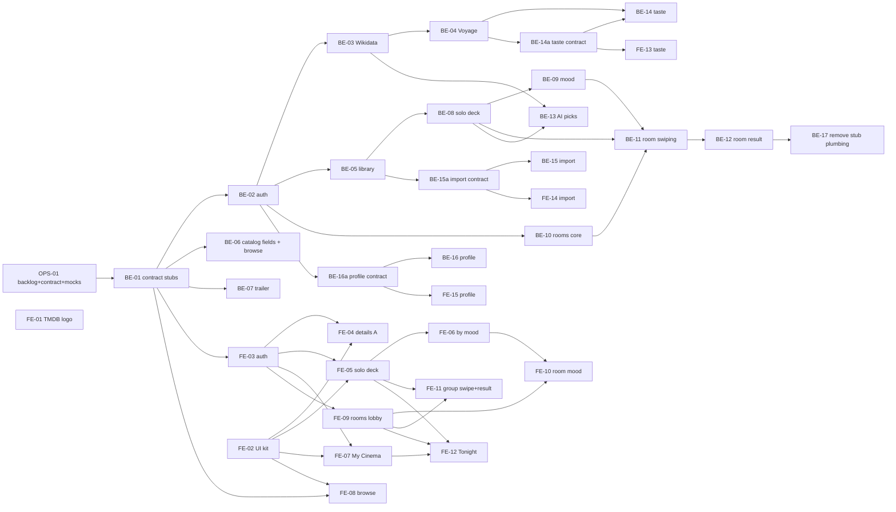

# Backlog

**What this is:** the ordered task list the backend and frontend agents work from, in parallel (ADR-0021).
**How to use it:** pick the lowest-numbered task **in your lane** whose dependencies are `done` and that nobody has
claimed, then follow AGENTS.md §4 (Claude: `/do-task <ID>`). The claim is a draft PR `[<ID>] …` opened right after your
first push (status `in progress` in your branch); the status here becomes `done` in the PR that finishes the task.
Frontend tasks depend on **contract** tasks (BE-01, BE-14a, BE-15a, BE-16a), never on backend logic.

Status values: `todo` · `in progress` · `done` · `blocked (#issue)`. Every task also has to meet AGENTS.md §2 (rules),
§4 (process) and end with the §5 report. "Tests" is the minimum.

Contract sections (`§n`) point to [docs/api-contract.md](api-contract.md). Mocks: every frontend task adds MSW handlers
for the endpoints it consumes (ADR-0020, [frontend conventions → Mock API](frontend-conventions.md#mock-api)).

---

## Lanes and order

**Why this order.**
1. **Contract stubs first (BE-01).** Every first-wave endpoint exists with its final DTOs and returns 501, so
   `contracts/openapi.json` and `schema.d.ts` exist before any logic. From then on the frontend builds every screen
   against MSW mocks typed from that schema and never waits for backend logic. Integration (mocks off) happens when the
   matching BE task is `done`.
2. **Auth next (BE-02 / FE-03).** Nearly every endpoint needs a user or a room member; the antiforgery header touches the
   shared API client.
3. **Wikidata, then Voyage (BE-03, BE-04)** come before the features, as the owner asked (ADR-0017, ADR-0013). Only
   BE-13 (AI picks) and BE-14 (taste) depend on them, so if they stall, the backend agent may take BE-05…BE-12 first and
   says so in its report.
4. **Library before decks (BE-05 → BE-08)** because a seen-it swipe writes `UserFilm`, and ADR-0019's
   refresh-not-purge rule must exist before anything references films.
5. **Rooms after the solo deck (BE-08 → BE-11)** because the shared deck reuses the deck builder.

**Parallel lanes once BE-01 is `done`:**

| Lane | Tasks, in order | Notes |
|---|---|---|
| Backend | BE-02 → BE-03 → BE-04 → BE-05 → BE-06 → BE-07 → BE-08 → BE-09 → BE-10 → BE-11 → BE-12 → BE-13 → BE-14a → BE-14 → BE-15a → BE-15 → BE-16a → BE-16 → BE-17 | BE-06/BE-07 need only BE-01; the `a` contract tasks are small and may be pulled earlier so FE-13–15 can start |
| Frontend | FE-01 (when approved) · FE-02 → FE-03 → FE-04 → FE-05 → FE-06 → FE-07 → FE-08 → FE-09 → FE-10 → FE-11 → FE-12 → FE-13 → FE-14 → FE-15 | FE-02 can start before BE-01; all FE tasks run on mocks; FE-13–15 wait for BE-14a/15a/16a |
| Ops | OPS-02 any time · OPS-03 after FE-05 + BE-08 | |

With a second agent per side, tasks with no path between them in the graph can also run in parallel (e.g. BE-06 ‖ BE-05,
FE-07 ‖ FE-08). Two backend tasks that both add a migration must merge one after the other: the second one deletes its
migration, rebases, and re-adds it (AGENTS.md §4).

---

## Foundation

### OPS-01 — Backlog, API contract, MSW mocks, parallel-agent workflow · `in progress`
- **Side:** ops (docs + frontend tooling). **Depends on:** — . **Contract:** writes docs/api-contract.md (design only).
- **Scope in:** docs/backlog.md, docs/api-contract.md, MSW (`src/frontend/src/mocks`, Vitest setup, dev toggle,
  production exclusion), ADR-0020/0021, AGENTS.md §4 workflow, `/do-task`, design reference in frontend-conventions.md.
  **Out:** any endpoint, entity or screen.
- **AC:** mocks answer `/api/health` and `/api/films/{tmdbId}` in dev and Vitest; unhandled requests fail tests; production
  build has no mock code (`check-no-mocks`); all §1 checks green.
- **Tests:** `src/mocks/handlers.test.ts`. **Docs:** the files above.

### BE-01 — Contract stubs for every first-wave endpoint · `todo`
- **Side:** backend. **Depends on:** OPS-01. **Contract:** implements the *shape* of §4–§9.
- **Scope in:** all request/response DTOs and enums of §3–§9 (Application/<Feature>/), one sealed service per feature with
  the final method signatures returning `Error` `server.not_implemented` (501), thin controllers with routes,
  `[ProducesResponseType]` for every status in the contract, `[Tags]`; all §2 error codes in `ErrorCodes`,
  `ErrorStatusCodes`, `problem.ts`, plus each feature's `<Feature>Errors`; `export-openapi.sh`; `npm run api:types`;
  `FilmDto` gains the new nullable fields (filled with null until BE-06). **Out:** auth enforcement, entities,
  migrations, any logic.
- **AC:** every endpoint of §4–§9 appears in `contracts/openapi.json` with the documented request, response and status
  codes; each returns 501 `server.not_implemented` ProblemDetails (except the existing films/health endpoints); enums are
  strings; the frontend compiles against the new `schema.d.ts`; mocks for `/api/films/{tmdbId}` still type-check.
- **Tests:** one parameterised slice test that each stub answers 501 with the code; `ErrorStatusCodesTests` and the
  OpenAPI drift test pass.
- **Docs:** api-contract.md (any deviation found while coding), backend-conventions.md: a line on stubs.

## Auth

### BE-02 — Users, guests, session and antiforgery (ADR-0012) · `todo`
- **Side:** backend. **Depends on:** BE-01. **Contract:** §4 (implements), §2 auth codes.
- **Scope in:** ASP.NET Core Identity on `AppDbContext` (users table, email + password, lockout 5/15 min), cookie scheme
  (HttpOnly, SameSite=Lax, Secure in Production, 401/403 JSON instead of redirects), `Guest` entity + guest principal in the
  same scheme carrying guest id + room id (issued by BE-10, plumbing here), an Application-level `ICurrentActor`
  (user/guest id, room scope) so services never touch `HttpContext`, antiforgery (`XSRF-TOKEN` cookie, `X-XSRF-TOKEN`
  header on unsafe methods, re-issued on principal change, failure → 400 `auth.antiforgery_failed`), `/api/auth/*`,
  migration. Copy FlowOps' patterns; record any deviation in an ADR. **Out:** Google/Apple sign-in (P-02), profile
  editing (BE-16), guest upgrade of votes (BE-10).
- **AC:** register → signed in (201) → `me` returns the user; wrong password and locked account answer identically; sign-out
  clears the cookie; a POST without the header → 400 `auth.antiforgery_failed`; unauthenticated → 401 JSON; tests still run
  offline (OfflineProviders).
- **Tests:** register/sign-in/sign-out/me; duplicate email; lockout; antiforgery missing/invalid; 401 shape; cookie flags.
- **Docs:** api-contract.md §4 "as built" notes; backend-conventions.md (how a service gets the actor); ADR if deviating.

### FE-03 — Sign-in screen and session (ADR-0012) · `todo`
- **Side:** frontend. **Depends on:** BE-01, FE-02. **Contract:** §4 (consumes).
- **Scope in:** `/sign-in` per the Welcome board (email sign-in, create account, "Have a room code?" → join), `useCurrentUser`
  / `useSignIn` / `useRegister` / `useSignOut` hooks, XSRF header in `shared/api/client.ts` (read `XSRF-TOKEN`, send
  `X-XSRF-TOKEN` on unsafe methods), a `RequireUser` route wrapper that sends anonymous visitors to `/sign-in?next=…`,
  sign-in/out in `MenuSheet`, mock auth handlers with a signed-in default and a switch for tests. **Out:** "Continue with
  Google" (rendered disabled or hidden until P-02), profile.
- **AC:** with mocks: sign in, refresh keeps the session, sign out; wrong password shows the `auth.invalid_credentials`
  message; field errors from 400 show under the fields; guest principal (`kind: "guest"`) is treated as not signed in for
  user-only routes.
- **Tests:** client XSRF header (Vitest + MSW), hook tests, `RequireUser` redirect (Testing Library).
- **Docs:** frontend-conventions.md (session + guard pattern).

## AI data (ADR-0017, ADR-0013)

### BE-03 — Wikidata enricher · `todo`
- **Side:** backend. **Depends on:** BE-02 (order only; no code dependency). **Contract:** none (internal).
- **Scope in:** an `IWikidataClient` (Application) + typed `HttpClient` (Infrastructure) over the Wikidata SPARQL endpoint,
  linking films by Wikidata's TMDB movie id property; store the AI-safe fields from ADR-0017 (genres, main subjects,
  directors, cast, countries, languages, year, runtime, awards) on our side (new columns or a `film_facts` table,
  migration); a deterministic "embedding text" builder from those fields only; run inside the catalog sync in batches
  (resumable, one save per batch); keep the 180-day TMDB rule untouched (Wikidata data is CC0 and not subject to it); a
  descriptive User-Agent with a project contact (no personal email). **Out:** embeddings (BE-04), Wikipedia text.
- **AC:** after a sync, films with a Wikidata match have facts and an embedding text; films without a match are logged and
  skipped; the embedding text never contains TMDB-derived text (a test proves it); no live calls in tests.
- **Tests:** stub `HttpMessageHandler` with recorded SPARQL responses; builder unit tests; "no TMDB text" test.
- **Docs:** docs/ai.md (data sources, enricher), glossary if a new term appears.

### BE-04 — Voyage embedding client (ADR-0013) · `todo`
- **Side:** backend. **Depends on:** BE-03. **Contract:** none (internal).
- **Scope in:** `VoyageEmbeddingClient : IEmbeddingClient` in `Infrastructure/Ai/`, typed `HttpClient` over
  `POST https://api.voyageai.com/v1/embeddings` (no official .NET SDK), model `voyage-4`, `output_dimension` 1024,
  `input_type` `document` for films and `query` for mood/taste text (extend `IEmbeddingClient` with a batch method and the
  input type), batches of up to 1,000 texts, back-off with `Retry-After` on 429 (low limits: no payment method yet); add
  `Voyage` to `AddExternalClients` + startup validation (key `Ai:EmbeddingApiKey` required); make the sync embed the
  Wikidata text in batches and **replace** `CatalogSync:EmbedOverviews` (TMDB text) with that. **Out:** taste vectors (BE-14).
- **AC:** with `Ai:EmbeddingProvider=Voyage` and no key, startup fails clearly; a sync embeds changed films only and records
  `embedding_model`; `EmbedOverviews` is gone; tests make no network calls.
- **Tests:** stub handler: request shape, batching, 429 back-off, dimension check, error → Result; sync test with the Fake.
- **Docs:** docs/ai.md (embeddings section, keys), ADR-0013 consequence note if needed.

## Library

### BE-05 — My Cinema: UserFilm + catalog retention (ADR-0019) · `todo`
- **Side:** backend. **Depends on:** BE-02. **Contract:** §7.
- **Scope in:** `UserFilm` entity + configuration + migration (FK to films `ON DELETE RESTRICT`), `LibraryService` (list,
  summary, get, put; rating ⇒ seen), the sync's refresh-by-reference step and orphan-only purge (ADR-0019), mark a
  TMDB-404 film unavailable instead of deleting it. **Out:** import (BE-15), taste (BE-14).
- **AC:** §7 behaves as written; a referenced film older than `MaxAgeDays` is refreshed, not purged; deleting a referenced
  film fails at the database.
- **Tests:** slice tests per endpoint and error; sync retention tests (referenced vs orphan, TMDB 404).
- **Docs:** api-contract.md §7 as built; docs/ai.md catalog sync section.

### FE-07 — My Cinema screen · `todo`
- **Side:** frontend. **Depends on:** BE-01, FE-02, FE-03. **Contract:** §7.
- **Scope in:** `/cinema` per the My Cinema board: counts header, shelves Liked / Watchlist / Watching / Seen with counts,
  genre filter and sort, poster grid with stubs/labels, empty state ("Nothing on the reel yet"), paging (load more),
  "Import" link to `/import`. **Out:** import itself, "FROM SAMI".
- **AC:** with mocks, each shelf lists, filters and pages; empty states per shelf; user-only (guard).
- **Tests:** shelf switch and empty state (Testing Library + MSW).
- **Docs:** none beyond the route map.

## Catalog and film details

### BE-06 — Catalog display fields and Browse · `todo`
- **Side:** backend. **Depends on:** BE-01. **Contract:** §3 (FilmDto additions), §9.
- **Scope in:** sync stores `backdropPath`, `voteAverage`, `voteCount`, `originalLanguage` (migration); `FilmDto` fills them;
  `GET /api/films` (filters, sort, paging) and `GET /api/films/genres`; `hideSeen` uses `UserFilm` when BE-05 is done (else
  ignored, noted). **Out:** where-to-watch (P-01).
- **AC:** §9 filters combine; paging per `PageRequest`; anonymous access works.
- **Tests:** slice tests for search, each filter, sort, paging bounds.
- **Docs:** api-contract.md §9 as built.

### BE-07 — Trailer, cached · `todo`
- **Side:** backend. **Depends on:** BE-01. **Contract:** §8.
- **Scope in:** `GET /api/films/{tmdbId}/trailer` via `ITmdbClient` (videos), first YouTube trailer, cached in the database
  ≤ 180 days (ADR-0003/0017); `tmdb.unavailable` only when nothing is cached. **Out:** other videos.
- **AC:** second call within the cache window makes no TMDB call; no trailer → `{ trailer: null }`.
- **Tests:** Fake TMDB client counts calls; 404 film; TMDB failure with and without cache.
- **Docs:** api-contract.md §8 as built.

### FE-04 — Film details (A) · `todo`
- **Side:** frontend. **Depends on:** BE-01, FE-02, FE-03. **Contract:** §7, §8.
- **Scope in:** rebuild `FilmPage` to the "Film details (A)" board: backdrop hero, poster, title, year · runtime, genres,
  ★ score + count, action row Like / Saved / Seen it / Trailer (library `PUT`, optimistic with rollback), overview, "Your
  rating" in 1–5 ticket stubs, trailer in a sheet/dialog (YouTube embed, privacy-enhanced domain), back and share
  (Web Share API, copy fallback). Signed-out visitors see the film; actions send them to `/sign-in`. **Out:** "WHY" note
  (P-03), certification, "Watch on Mubi / Rent on Apple TV / Open in Letterboxd" (P-01). Ignore the "Direction B" board.
- **AC:** with mocks: toggles and rating persist and survive reload; a failed `PUT` rolls back with a toast; 375px layout
  matches the board; touch targets ≥ 44px.
- **Tests:** toggle + rollback; rating radio group keyboard use.
- **Docs:** none.

### FE-08 — Browse · `todo`
- **Side:** frontend. **Depends on:** BE-01, FE-02. **Contract:** §9.
- **Scope in:** `/browse` per the board: search, filter chips (Under 2h, Hide seen, ★ 7+), "Trending this week" (sort
  popular), genre tiles from `GET /api/films/genres`, results grid with paging; filters in the URL query. **Out:** "On my
  services", "New on Netflix, Mubi & Prime" (P-01).
- **AC:** with mocks, search and filters update results and URL; back button restores them.
- **Tests:** filter → request query (MSW assertion).
- **Docs:** none.

## Decks (solo)

### BE-08 — Solo deck: Just swipe · `todo`
- **Side:** backend. **Depends on:** BE-02, BE-05. **Contract:** §5 (`source: "justSwipe"`).
- **Scope in:** deck + `DeckItem` entities (⚠ the glossary has no entity for a solo deck's parent; propose the name in
  the PR and update the glossary, together with a name for a solo swipe record: A12), sampler (varied genres/decades by popularity), adaptive next batches from the user's own
  swipes and library (genres, runtime; embeddings when present), swipes with idempotent `swipeId`, library effects of `up`,
  top 3 by our own data (`reason: null`). **Out:** mood (BE-09), AI ranking (BE-13), taste (BE-14).
- **AC:** §5 for `justSwipe`; no film twice in a deck; films the user marked seen are excluded; retrying a swipe is a no-op.
- **Tests:** slice tests per endpoint/error; sampler variety; adaptation unit tests; idempotency.
- **Docs:** api-contract.md §5 as built; glossary.

### FE-05 — Solo deck, swipe and top 3 · `todo`
- **Side:** frontend. **Depends on:** BE-01, FE-02, FE-03. **Contract:** §5.
- **Scope in:** `/deck` (start Just swipe → `POST /api/decks` → `/deck/:deckId`), the swipe screen per "Solo — the deck"
  (card stack, drag gestures right/left/up with buttons and keyboard as equivalents, up → Loved it / Not for me / Skip
  sheet, progress "N swipes", prefetch the next batch near the end), top 3 per "Solo — your top 3" at
  `/deck/:deckId/top`; a reusable `SwipeCard`/`useSwipeGesture` for FE-11; `prefers-reduced-motion`. **Out:** "learning"
  chips (no contract yet), where-to-watch lines on the top 3.
- **AC:** with mocks: swipe a full batch by touch, mouse and keyboard; each swipe sends one request with a stable
  `swipeId`; a failed swipe shows a toast and the card returns; top 3 renders 1–3 picks and `deck.no_yeses`.
- **Tests:** gesture → direction mapping (pure), swipe mutation idempotency, screen flow with MSW.
- **Docs:** routes (A4) in frontend-conventions.md.

### BE-09 — Decks by mood · `todo`
- **Side:** backend. **Depends on:** BE-08. **Contract:** §5 (`source: "mood"`, `MoodQuery`).
- **Scope in:** `MoodQuery` entity; chips → genre/filter mapping (server-side table, no LLM); free text → `mood-parse.v1`
  (existing prompt, `MoodParseOutput`), then validate genres against our list; runtime and language filters; deck built
  from the filters. **Out:** room moods (BE-11 reuses this), new prompt versions unless evals need them.
- **AC:** §5 for `mood`; AI failures map to the ai.* codes; mood text never appears in logs.
- **Tests:** mapping table; Fake LLM output → filters; invalid genres dropped; eval case still green.
- **Docs:** docs/ai.md (mood flow), api-contract.md §5 as built.

### FE-06 — By mood picker · `todo`
- **Side:** frontend. **Depends on:** FE-05. **Contract:** §5.
- **Scope in:** `/mood` per "Solo — by mood": mood chips (max 2), "How long have you got?", language, "Describe it your
  way" text, "Deal my deck" → `POST /api/decks` (`source: "mood"`) → `/deck/:deckId`; AI error states. A shared
  `MoodPicker` component reused by FE-10. **Out:** "More filters".
- **AC:** with mocks: validation (max 2 moods, ≤ 280 chars), loading while the LLM works, each ai.* error shows its message.
- **Tests:** picker state; error mapping.
- **Docs:** none.

## Rooms

### BE-10 — Rooms core: create, preview, join, leave, close, hub membership · `todo`
- **Side:** backend. **Depends on:** BE-02. **Contract:** §6 (create, preview, join, get, leave, close), realtime
  `memberJoined` / `memberLeft` / `roomClosed`.
- **Scope in:** `Room`, `RoomMember` (user or guest), room codes, guest cookie on join (ADR-0012), max 8 members,
  `RoomHub.JoinRoom(code)` / `LeaveRoom(code)` calling a membership service, events after commit, guest upgrade on
  register/sign-in (moves member + votes). **Out:** mood step, deck, votes (BE-11), result (BE-12).
- **AC:** §6 rows above; a guest cookie works only for its room; a non-member can't join the hub group; events fire once per
  change and never fail the request.
- **Tests:** slice tests per endpoint/error; hub membership test (SignalR client in tests, add the package with a reason);
  guest scope; upgrade.
- **Docs:** docs/realtime.md (as built), api-contract.md §6.

### BE-11 — Room swiping: mood step, start, shared deck, votes, progress · `todo`
- **Side:** backend. **Depends on:** BE-10, BE-08, BE-09. **Contract:** §6 (mood, start, deck, votes, progress), realtime
  `voteCast` / `deckExtended`.
- **Scope in:** per-member mood + private hard nos, readiness, start (first batch from the combined moods or the sampler,
  hard nos excluded), votes (ADR-0015 idempotency), progress, deck extension when members near the end. **Out:** match and
  compromise (BE-12).
- **AC:** §6 rules for these rows; hard-no films never enter the deck; duplicate votes are no-ops; `voteCast` carries no values.
- **Tests:** slice tests; hard-no exclusion; concurrent votes on the same item (≥ 20 runs).
- **Docs:** api-contract.md §6 as built.

### BE-12 — Room result: match and best compromise · `todo`
- **Side:** backend. **Depends on:** BE-11. **Contract:** §6 (finish, result), realtime `roomMatched`.
- **Scope in:** match detection on each vote, automatic compromise when everyone finished, host `finish`, ranking rule
  from §6, result with per-member votes on the picks, `roomMatched` after commit. **Out:** AI reasons (BE-13), tiebreak and
  "swipe more" (P-04).
- **AC:** unanimous right → match exactly once even under concurrent votes; compromise order as specified; hard nos never in
  the result.
- **Tests:** rule unit tests (ties); concurrency test; slice tests.
- **Docs:** api-contract.md §6 as built; glossary (Match / Best compromise wording if refined).

### FE-09 — Rooms: create, join, lobby · `todo`
- **Side:** frontend. **Depends on:** BE-01, FE-02, FE-03. **Contract:** §6, realtime events.
- **Scope in:** create a room (name, mode) from Tonight-with-friends and `/rooms`; join by code; `/rooms/:code` for a
  non-member = preview + display-name form (guest) or one-tap join (user); lobby per "Group — lobby" (ticket header with
  code, copy link / Web Share, members with ready state, host "Start swiping · N OF M READY", leave); `useRoomHub` with
  `JoinRoom` (extend `shared/realtime` with the hub invocation; handlers invalidate room queries); mock handlers for rooms
  with a scriptable store. **Out:** "Nudge" / invited seats (P-04), room settings menu.
- **AC:** with mocks: create → lobby; a second browser profile can join as a guest (mocks per browser are independent — use
  the real API for this check once BE-10 is done); host-only controls hidden for others but enforced by the server.
- **Tests:** join form validation; lobby renders members/readiness; hub handler invalidates the right keys.
- **Docs:** docs/realtime.md client section (JoinRoom usage).

### FE-10 — Room mood step · `todo`
- **Side:** frontend. **Depends on:** FE-09, FE-06. **Contract:** §6 (`PUT …/mood`).
- **Scope in:** "Group — your mood tonight" inside `/rooms/:code` for `mood` rooms: `MoodPicker`, "How long can you stay
  up?", hard nos (marked private), "I'm ready", who's ready. **Out:** —.
- **AC:** with mocks: submit → ready; others' readiness updates on `memberJoined`/refetch.
- **Tests:** submit + ready state.
- **Docs:** none.

### FE-11 — Group swipe and result · `todo`
- **Side:** frontend. **Depends on:** FE-09, FE-05. **Contract:** §6 (deck, votes, progress, finish, result), realtime
  `voteCast`, `deckExtended`, `roomMatched`, `roomClosed`.
- **Scope in:** `/rooms/:code/swipe` per "Group — swipe" (reuses `SwipeCard`; "LIVE · N SWIPING", position "4 OF 12"),
  votes with `voteId`, navigate to `/rooms/:code/result` on `roomMatched`; result per "It's a match" and "Close call"
  boards (match burst uses Shrikhand — a big moment); host "finish"; desktop ≥ lg layout per "Desktop — group swipe".
  **Out:** "Watch on Netflix", "Run it back", tiebreak, "Swipe 6 more" (P-01, P-04).
- **AC:** with mocks: vote through a deck; simulated `roomMatched` (mock store) moves everyone to the result; reconnect
  invalidates room queries.
- **Tests:** vote idempotency; event → navigation; result renders both kinds.
- **Docs:** none.

## AI picks, taste, import, profile, home

### BE-13 — AI picks: ranking and reasons from Wikidata · `todo`
- **Side:** backend. **Depends on:** BE-03, BE-08 (BE-12 for rooms). **Contract:** §5 `TopPickDto.reason`, later
  `RoomPickDto` reason (additive contract change in this task).
- **Scope in:** `rank-candidates` / `explain-pick` over **Wikidata facts + our own user data only** (ADR-0017); every
  returned `tmdbId` validated against the candidates; Fake + recorded evals; configure the existing `Ai:ModelOverrides`
  for the new prompts (cost).
- **AC:** no TMDB text in any prompt (test); invalid ids dropped; AI failure → picks without reasons, not an error.
- **Tests:** prompt-variable test; eval cases incl. a "must not" case.
- **Docs:** docs/ai.md; prompts README.

### BE-14a — Taste contract and stubs · `todo`
- **Side:** backend. **Depends on:** BE-04. **Contract:** writes §12 (Taste) in api-contract.md: `GET /api/taste`,
  `source: "taste"` for decks, `mode: "taste"` for rooms (additive enum values); DTOs + 501 stubs + openapi + api:types,
  like BE-01. **AC:** FE-13 can build on mocks.

### BE-14 — Taste profile and decks by taste · `todo`
- **Side:** backend. **Depends on:** BE-14a, BE-05, BE-08. **Contract:** §12 (implements).
- **Scope in:** `TasteProfile` from embeddings of liked/rated films, readiness threshold, taste decks, group taste that skips
  films any member has seen (guests: A11).
- **AC / Tests / Docs:** defined in the contract section this task writes; at least slice tests and a deterministic vector test.

### FE-13 — By taste screen · `todo`
- **Side:** frontend. **Depends on:** BE-14a, FE-05. **Contract:** §12.
- **Scope in:** `/taste` per "Solo — by taste". **AC/Tests:** per the contract; with mocks.

### BE-15a — Import contract and stubs · `todo`
- **Side:** backend. **Depends on:** BE-05. **Contract:** writes §13 (Import): upload, `ImportJob` status, results;
  DTOs + 501 stubs, like BE-01.

### BE-15 — Letterboxd import (ImportJob) · `todo`
- **Side:** backend. **Depends on:** BE-15a. **Contract:** §13 (implements).
- **Scope in:** upload CSV/ZIP, `ImportJob` with progress, match by title + year to our catalog (no live TMDB on the
  request path; unmatched rows reported), write `UserFilm` (Letterboxd half stars → our 1–5: rule in the contract).
- **AC / Tests / Docs:** per the contract section; fixture files in tests, no network.

### FE-14 — Import screen · `todo`
- **Side:** frontend. **Depends on:** BE-15a, FE-02. **Contract:** §13. **Scope in:** `/import` per the board.

### BE-16a — Profile contract and stubs · `todo`
- **Side:** backend. **Depends on:** BE-02. **Contract:** writes §14 (Profile): display name, password change, delete
  account (decide with the owner what deletion removes); DTOs + 501 stubs, like BE-01.

### BE-16 — Profile · `todo`
- **Side:** backend. **Depends on:** BE-16a. **Contract:** §14 (implements).

### FE-15 — Profile & settings screen · `todo`
- **Side:** frontend. **Depends on:** BE-16a, FE-03. **Contract:** §14. **Scope in:** `/profile` per the board.

### FE-12 — Tonight (home) · `todo`
- **Side:** frontend. **Depends on:** FE-05, FE-07, FE-09. **Contract:** §4 (`me`), §5, §6, §7 (summary, watching).
- **Scope in:** `/` per "Tonight — Just me" and "Tonight — With friends" (direction **A**; ignore "Direction B
  (refined)"): greeting with day/time, Just me / With friends toggle, hero ticket (Just swipe / Start a room), "By mood" and
  "By taste" ticket cards (taste disabled until FE-13), keep-watching row from the Watching shelf, room-code join; desktop
  ≥ lg per "Desktop — Tonight". **Out:** "Restart Friday Film Club" (P-04), "42 min left" (A9).
- **AC:** signed-out visitors see the toggle and can join a room by code; everything else leads to `/sign-in`.
- **Tests:** toggle + navigation targets.
- **Docs:** none.

## Ops and quality

### FE-01 — TMDB logo in the footer · `todo` (needs the owner's OK to download the asset)
- **Side:** frontend. **Depends on:** owner approval. **Contract:** none.
- **Scope in:** the official logo from TMDB's branding page, stored under `src/frontend/src/shared/ui/` (or `public/`),
  rendered in `AppFooter` next to the existing notice, visibly less prominent than the Ithaca wordmark (TMDB terms,
  ADR-0017); alt text. **Out:** any other TMDB branding.
- **AC:** logo on every page; smaller than the wordmark; passes token lint (SVG colours stay in the asset).
- **Tests:** none beyond build. **Docs:** ADR-0017 "logo still TODO" note resolved (amend via a short follow-up line, not
  by rewriting the decision).

### FE-02 — UI kit from the design canvas · `todo`
- **Side:** frontend. **Depends on:** — (can start before BE-01). **Contract:** none.
- **Scope in:** in `src/shared/ui/`: pill `Button` (primary ink / yellow / pink / outline), `IconButton` (44px, aria-label
  required), `TicketCard` (dashed tear line, notches, "ADMIT 1" stub), `Chip` / `ToggleChip`, `SegmentedControl`,
  `Poster` (TMDB image URL builder + placeholder), `StubRating` (1–5 ticket stubs, radio group), `Sheet` (native
  `<dialog>`), `MonoLabel`; Testing Library + jsdom for component tests (ADR-0010 said "when needed": now). **Out:**
  screens.
- **AC:** each piece matches the visual language in frontend-conventions.md, uses tokens only, keyboard and screen-reader
  usable; a `/dev/ui` gallery page (dev builds only) shows them.
- **Tests:** StubRating keyboard, Sheet focus handling, Button variants render.
- **Docs:** frontend-conventions.md (shared UI list).

### OPS-02 — GitHub issue labels and templates · `todo`
- **Side:** ops. **Depends on:** OPS-01. **Scope in:** create the labels AGENTS.md §4 uses (`backend`, `frontend`,
  `contract`, `docs`, `infra` × `bug`, `blocker`, `decision-needed`, `security`, `tech-debt`) and a short issue template.
- **AC:** `gh label list` shows them.

### OPS-03 — Playwright smoke on the Docker stack · `todo`
- **Side:** ops. **Depends on:** BE-02, BE-08, FE-03, FE-05. **Scope in:** Playwright in `src/frontend` (or `tests/e2e`),
  a CI job against `docker compose up` (Fake providers): register → Just swipe → swipe 3 cards → open film details; phone
  viewport. **AC:** green in CI; no external network.

### BE-17 — Remove the contract-stub plumbing · `todo`
- **Side:** backend. **Depends on:** all first-wave BE tasks. **Scope in:** delete `server.not_implemented` from the three
  code lists and its tests once no endpoint returns it.

---

## Proposed, unscheduled (need the owner's approval before anyone starts)

| Id | Proposal | Why it's parked |
|---|---|---|
| P-01 | **Where to watch**: "Watch on Mubi / Rent on Apple TV / Open in Letterboxd" (details, top 3, match), "On my services", "New on Netflix, Mubi & Prime". Source: TMDB watch providers (data by JustWatch), which requires JustWatch attribution; Letterboxd deep link by TMDB id. | Not in scope yet; new attribution and terms to check; affects ADR-0017. |
| P-02 | Google / Apple sign-in ("Continue with Google" on the Welcome board) | ADR-0012 says "later". |
| P-03 | Personal "WHY" note on film details ("You gave Hollow Pines five stubs…") | Needs taste (BE-14) + Wikidata (BE-03) + a new prompt. |
| P-04 | Room extras: Nudge / invited seats, "Restart with the same friends", tiebreak, "Swipe 6 more", "Run it back", shared watchlist ("FROM SAMI") | Invites/nudges border on notifications (ADR-0014). |
| P-05 | Anonymous solo "Just swipe" | Needs an auth decision (A3). |
| P-06 | "Learning" chips on the solo deck (+ Mysteries, − Horror) | Needs a contract for deck signals. |

## Open questions for the owner

Contract assumptions A1–A14 are listed in [api-contract.md §11](api-contract.md#11-open-questions). Also:
- **Solo deck parent entity:** the glossary has `DeckItem` but no name for a solo deck's owner record (BE-08 proposes one).
- **Task order:** Wikidata/Voyage (BE-03/04) are placed right after auth as requested, although only BE-13/BE-14 need them.
